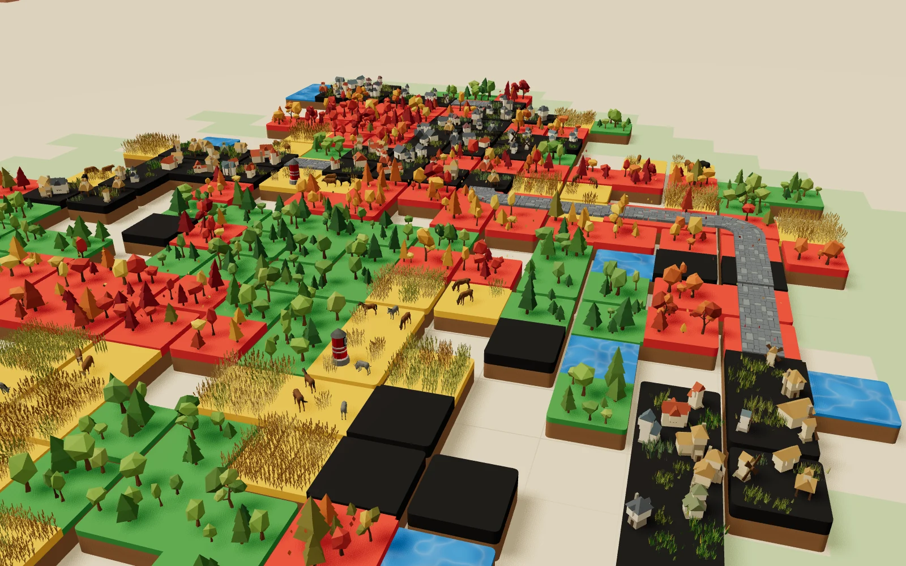
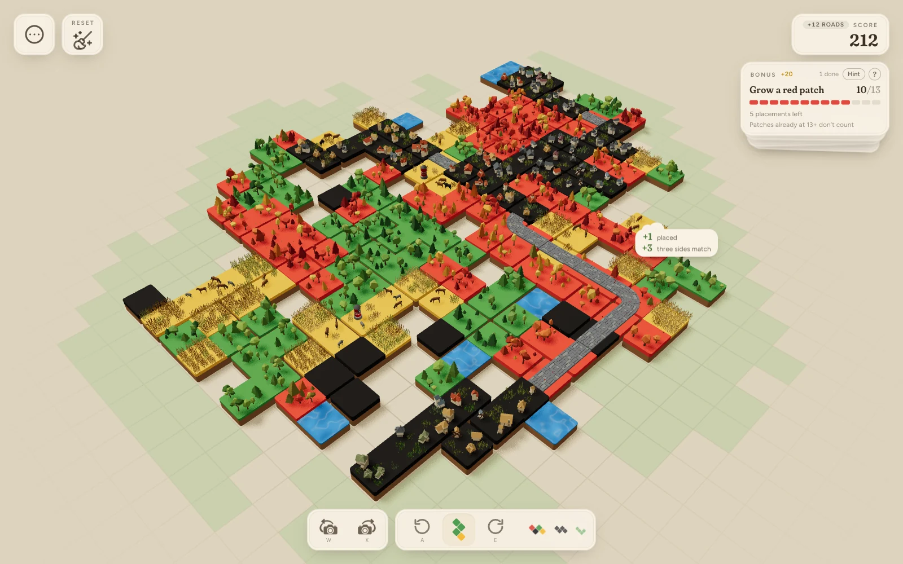
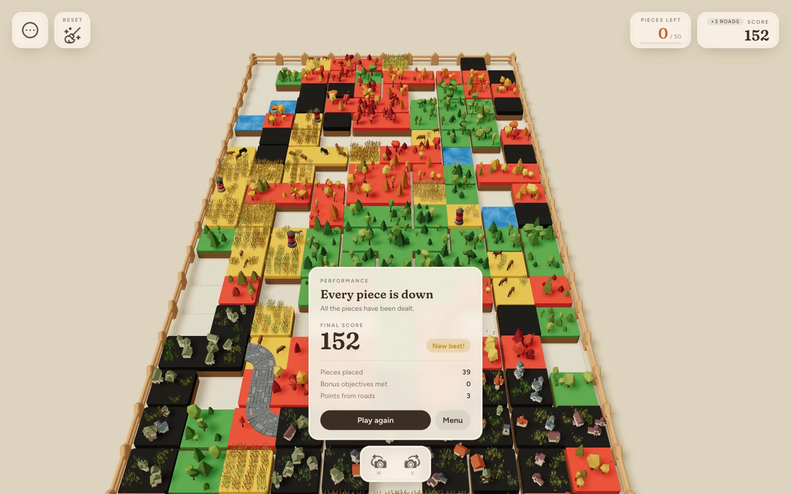

<h1 align="center">TrisTik</h1>

<p align="center">
  A cozy tile-placement game played with tetrominoes, in 3D, in the browser.
</p>

<p align="center">
  <a href="https://fadi1089.github.io/autristik/"><strong>Play it now</strong></a> ·
  <a href="docs/GUIDE.md">Full rules</a> ·
  <a href="docs/DEVELOPMENT.md">Development</a>
</p>

<p align="center">
  
</p>

Every piece is four biome squares shaped as an I, O, T, S, Z, J or L. Lay each one against the
board, match biomes along the edges, and the world builds itself around you: woods grow on
green, wheat and herds on yellow, towns rise from five or more black squares, and stone roads
find their own way between towns.

<table>
  <tr>
    <td></td>
    <td></td>
  </tr>
  <tr>
    <td align="center">Score mode: points per match, bonus objectives, roads</td>
    <td align="center">Performance mode: 50 pieces, one fenced grid</td>
  </tr>
</table>

## How it plays

- **Place** a piece so it touches the board. Only blue can sit against blue.
- **Score** a point per piece and per matching edge, 10 for closing a piece in on all sides, and
  one per square of road between towns.
- **Chase bonus objectives**: every ten placements the game asks for a patch of one biome
  (seven to thirteen squares) and gives you ten placements to grow it, for 20 points.
- **Pick a mode**: Creation (free building, no rules), Score (endless) or Performance (50
  pieces on a 10 × 20 grid, best score kept).

Mouse, touch or keyboard alone, with rebindable keys and AZERTY support. Games save to and load
from a JSON file, and `?seed=123` in the URL replays the same pieces.
[Full rules →](docs/GUIDE.md)

## Under the hood

- **Roads that route themselves.** After every placement, towns are found by flood fill and
  every pair is joined by an A\* search that tracks how many yellow squares a path has used, so a
  longer road with no yellow isn't discarded for a shorter one that spent its only yellow.
  Kruskal's algorithm then keeps the shortest set of roads that links every town it can.
  ([`routes.ts`](src/game/routes.ts))
- **Pure game core.** All rules live in `src/game/` as plain TypeScript with no React or Three.js
  imports, enforced by ESLint. A seedable PRNG makes every game reproducible.
- **234 tests** across 23 files, including one test save per feature in [`saves/`](saves) whose
  every claim is checked automatically.
- **Procedural scenery.** Live water on blue squares, trees that fall over and grow back when a
  road passes through, harvested wheat, animals hopping out of the way. Models are rebuilt from
  their sources by Blender scripts in [`tools/`](tools).
- **CI/CD.** Lint, format check, tests and a type-checked build on every push, with deploys to
  GitHub Pages and GitLab Pages.

**Stack:** TypeScript, React 19, Three.js with React Three Fiber and drei, Zustand, Tailwind CSS
v4, Vite, Vitest.

## Run it locally

```sh
npm install
npm run dev    # http://localhost:5173/autristik/
npm test
```

Node.js 22.12 or newer. Builds, deploys and the project layout are in
[docs/DEVELOPMENT.md](docs/DEVELOPMENT.md).

## Team

A group project at the University of Strasbourg by Fadi Sultan, Nathan Reutenauer and brezeky.

## Credits

3D models from [Poly Pizza](https://poly.pizza), repainted in the game's own palettes:
["Fantasy Houses"](https://poly.pizza/m/AO4BeeUHLN) by burunduk,
["grass yellowing"](https://poly.pizza/m/eFUpFgjCf0p) by Steve B,
["Forest"](https://poly.pizza/m/79xo-C_-n1J) by Nathan Merrill, and
["Forest"](https://poly.pizza/m/2_fv3tn3NG_), ["Silo"](https://poly.pizza/m/8UPiiP129yz) and
["Field of wheat"](https://poly.pizza/m/eWhaaKNh755) by Poly by Google, all
[CC BY 3.0](https://creativecommons.org/licenses/by/3.0/); the animals and the road path by
Quaternius, [CC0](https://creativecommons.org/publicdomain/zero/1.0/). Details of how each model
was adapted are in [docs/CREDITS.md](docs/CREDITS.md).
