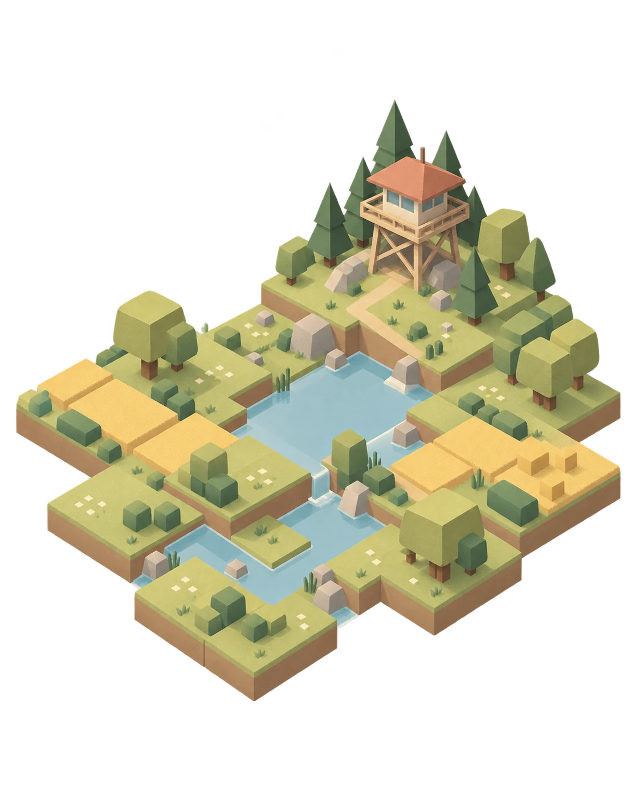

<div align="center">

# Autristik

<p align="center"></p>

<p align="center"><strong><a href="https://autristic.pages.unistra.fr/autristik/">▶ Play in your browser</a></strong> · no install needed</p>

</div>   

A falling tile game combining Tetris-style automatic movement with Dorfromantik terrain matching.
Guide square tiles sideways and rotate them as they fall towards the board. Each tile is split into
four terrain squares; matching squares across a seam score points.

Built with Vite, React, TypeScript, Three.js (`@react-three/fiber` + `drei`), Zustand and Tailwind CSS v4.
Available in English and French.

## How to play

- Each tile is a **2×2 grid** of terrain squares: meadow, forest, field, water or village.
- A tile falls towards the stack on its own (one square every 1.5 s at level 1 on Easy).
  Steer it sideways, rotate it, swap it with the next tile, or drop it immediately.
- Where two tiles meet, each square faces one square of the other tile. Matching squares score points.
- Reach the level's score goal to get 6 more tiles. The game ends when the supply is empty.

### Scoring

| Placement                                               | Reward                |
| ------------------------------------------------------- | --------------------- |
| Each matching square along a seam                       | +5 points             |
| Harmonious: every touching side fully matches, 2+ sides | +1 tile               |
| Perfect: all four sides occupied and fully matching     | +30 points, +2 tiles  |

**Combo:** each placement with a fully matching side and no mismatch adds ×0.25 to the multiplier
(×1.25, ×1.5 … capped at ×3). Any mismatch resets it. **Level goal:** `75 + 50 × (n − 1)` points.

### Controls

| Key                       | Action                                           |
| ------------------------- | ------------------------------------------------ |
| Arrows or `W` `A` `S` `D` | Move sideways / advance (relative to the camera) |
| `Shift` + movement key    | Choose the arrival side                          |
| `Space` / `Enter`         | Place immediately                                |
| `E` / `Q`                 | Rotate clockwise / anticlockwise                 |
| `F`                       | Swap current and next tile                       |
| `Esc`                     | Menu / pause                                     |

Mouse: click a lane to aim, left-drag to pan, wheel to zoom, right-drag to tilt and turn.
Keys can be remapped and AZERTY / QWERTY are both supported.

## Game options

| Option         | Choices                                                                           |
| -------------- | --------------------------------------------------------------------------------- |
| **Gamemode**   | **Classique** (ordinary tiles only) · **Superblock** (jokers, void, bedrock, bonus tiles) |
| **Format**     | **Standard** (score goals, no time limit) · **Time-attack** (45 s per level)      |
| **Difficulty** | Easy 15 s · Medium 10 s · Hard 7.5 s · Insane 5 s per tile (starting cadence)     |

Best scores are saved locally for each of the four format/gamemode combinations.

## Documentation

| Document                                                    | What's inside                                                              |
| ----------------------------------------------------------- | -------------------------------------------------------------------------- |
| [Gameplay and controls](docs/gameplay.md)                   | Arrival sides, islands, cavities, tile tray, full key list, camera         |
| [Scoring, modes and special tiles](docs/modes-and-tiles.md) | Combo details, Time-attack rules, records, joker / void / bedrock / bonus  |
| [Menus, settings and audio](docs/settings-and-audio.md)     | Themes, language, sounds, music                                            |
| [Development and deployment](docs/development.md)           | Scripts, tests, base path, `(RELEASE)` flow, project layout                |
| [Cadence balancing](docs/equilibrage-cadence.md)            | Tetris comparison and supply/duration estimates                            |

## Getting started

Requires Node.js 22.12 or newer.

```sh
npm install
npm run dev      # dev server (e.g. http://localhost:5173/autristik/)
npm test         # unit tests
npm run build    # type-check + production build
```

Add `?seed=123` to the URL to replay the same sequence of tiles.

## Credits

Audio sources and CC0 licence notices: [static/audio/CREDITS.md](static/audio/CREDITS.md).
Fonts (Fraunces, Figtree) are bundled from `@fontsource-variable`; the built site makes no requests
to external font hosts.
