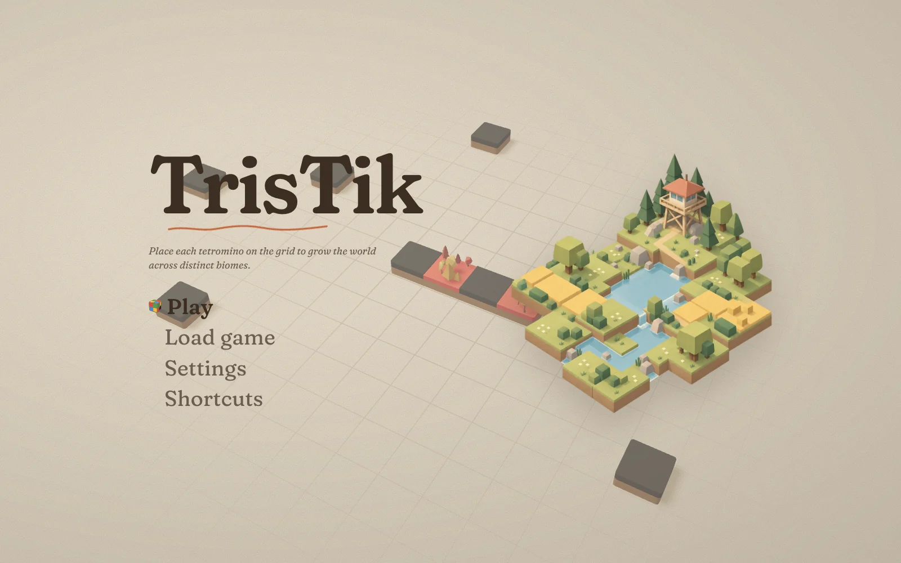

# How to play

The full rules of TrisTik. The [README](../README.md) has the short version.

There are five biomes: black, red, green, yellow and blue, one per board cell. Each of the seven
shapes is equally likely by default. A piece first draws how many distinct biomes it has (by default 1: 15%,
2: 45%, 3: 25%, 4: 15%), then picks that many different biomes by weight (red and green 30,
black and yellow 17.5, blue 5). Each picked biome gets one square. The squares left over are
filled from the picked biomes only, in proportion to their weights scaled to 100% among them:
a red and blue piece fills each spare square with red 30/35 of the time and blue 5/35. All
three sets of odds (shapes, biome counts and biomes) can be changed in the settings, in every mode. A placed piece is one low block whose squares meet
flush, with slightly rounded outer corners, and a thin strip of ground separates it from its
neighbours. Cell outlines are drawn on the ground, strongest at the centre of the view and fading
towards the edges.

## Modes

Play or New game in the menu offers three modes. The one played last is selected first.

| Mode        | What it is                                                                      |
| ----------- | ------------------------------------------------------------------------------- |
| Creation    | No score and no rules: lay each piece on any free cells, anywhere               |
| Score       | The endless game described below, with points and bonus objectives              |
| Performance | The score game with 50 pieces on a 10 × 20 grid: make the highest score you can |

**Creation.** A piece only needs free cells: it doesn't have to touch the board, and any biome
can go against blue. Two squares still can't share a cell. There is no score, no score cloud and
no bonus objective; a card saying "Creation, Free build" stands where the score would be. Roads,
houses, forests and farms still grow as usual. There is no green placement area, since every
free cell is one.

**Performance.** The rules and the scoring are those of the score game, on a grid of 10 columns
by 20 rows, drawn as a lighter field inside a wooden fence of pointed pickets and two rails, with cell lines only within it. The
starting piece sits near its centre and the single black tiles all land inside it. No square may
go off the grid. A card beside the score counts the pieces left, the one in hand included, from
50 down, and turns clay for the last five; the tray never shows more pieces than are left.
Skipping a piece that fits nowhere uses it up. The game ends when the 50th piece is placed or
skipped, or earlier if the grid has no room left for any piece (no four free cells joined
together beside the board). The 200 cells can't hold all 50 pieces, so packing them well counts.
A card then gives the final score, why the game ended, the pieces placed, the bonus objectives met
and the points from roads, with "New best!" or the best score so far, which the browser keeps.
"Play again" starts another performance game. The last placement settles the open bonus
objective and proposes no new one. Reset grid in this mode deals the 50 pieces again.

## Rules

| Rule    | What it means                                                        |
| ------- | -------------------------------------------------------------------- |
| Contact | A piece must share at least one edge with a square on the board.     |
| Overlap | A piece can't cover a cell that is already taken.                    |
| Water   | Only blue can go against blue on the board; blue can go against all. |

The game starts with one random piece at the centre, which is the only piece placed without
contact. It is never all blue, unless the settings allow nothing but blue, since only blue could
ever be laid against it. Squares within the same piece can sit next to each other in any
combination. Squares that only meet at a corner don't count as touching.

In the score game there is no timer or end: it keeps drawing pieces. Add `?seed=123` to the URL to replay
the same sequence of pieces.

## Score

Each piece scores when it is placed, and roads score for as long as they stand:

| Points | For                                                                 |
| ------ | ------------------------------------------------------------------- |
| 1      | Each piece laid down                                                |
| 1      | Each edge where the piece meets its own biome on another piece      |
| 10     | Each piece, this one or one already down, that it leaves surrounded |
| 1      | Each square a road crosses, while the road stands                   |
| 20     | Each bonus objective completed within its ten-placement window      |

A piece is surrounded when every one of its outer edges meets a square of its own biome on another
piece. The moment it scores its 10 the whole piece flashes gold, like a camera flash. It only scores
once. Edges between squares of the same piece don't count. After each placement a little cloud
floats up over the piece, listing its points line by line in the order of the table: "+1 placed",
then "+2 two sides match" if any sides match, then a gold "+10 tetromino surrounded" if it
surrounded a piece, then "+4 road squares" if it made a road longer or new, or "−2 road
shortened" if a shorter road took over. The total sits in the top right, with the points the
roads bring in now beside it ("+4 roads"). The starting piece counts for its base point, so a new
game starts at 1, and resetting the grid puts the score back to 1.

## Bonus objectives

After the 10th player placement, and every ten placements after that, a bonus objective asks
for a connected region of one biome. The biome is drawn uniformly from all five biomes,
independently of the piece settings (including biomes whose piece weight is zero). Its size is
drawn uniformly from 7 through 13 inclusive: each size has a 1/7 chance. A separate seeded random
stream keeps these draws from changing the upcoming pieces.

The next ten successful placements are the deadline: the objective proposed after placement 10
can be completed on placements 11 through 20, including placement 20. That last placement is
checked before the next objective is proposed. Invalid placements, rotations and skipped pieces
do not advance the counter. Neither the starting tetromino nor the scattered single black tiles
count as player placements.

A region joins squares of the requested biome along their sides, across piece boundaries;
diagonal contact does not join them. A placement must take a region from below the target to
the target or higher, either by growing it or joining smaller regions. A region that was already
large enough does not count retroactively, even if more squares are added to it; another region
may still qualify. Success adds 20 points once and increments the completed-objective counter.
Completing early leaves the completed objective visible until the next ten-placement milestone.
An unmet objective is replaced at its deadline without a penalty.

From the tenth player placement, a card below the score shows the current objective ("Grow a
green patch", 5/8) and a meter with one segment per square asked for, filled in the biome's
colour up to the largest region that can still count. Under it are the placements left, which
turn clay for the last three, and, when the board already has a region at the target, a reminder
that it doesn't count. The card rises in afresh for each new objective and counts the objectives
done this game.

Earlier objectives stack behind the current card like a deck of cards, newest first, with the
edges of up to three showing below it. Each is a small card with the patch it asked for, its
placements, and "✓ +20" or "Missed". Hovering the stack spreads them into a list to scroll
through, with the current card staying put on top; moving away stacks them again. On a touch
screen a tap spreads them, a drag scrolls, and a tap elsewhere stacks them.

On the board, the empty cells beside that largest region blink three times, in a darker shade of
the biome asked for, when the objective appears, then fade away: a square of the biome there grows
the region. The card's Hint button blinks them again. Cells touching a region that is already too big, or touching blue, are
left out.

The card's (?) button opens two screenshots from the game: a patch of four grown to eight
("Counts") and a patch that was already eight before the objective ("Doesn't count"), each with a
one-line reason. Esc or a click elsewhere closes it.

Its reward also appears in the placement's score cloud, and a light sprinkle of confetti drifts
down from the top of the screen, in gold, paper cream and the objective's biome, fading out about
halfway down. It never takes a click, and it is left out for players who prefer reduced motion. New games and grid
resets clear both objective counters and the earlier objectives along with the score. Saving and
loading preserves the objective, deadline, counters, earlier objectives and independent random
state; saves from before the earlier objectives were kept load with none. Older saves remain readable: their
placed tetrominoes determine the placement count, with no invented past completions; their first
new objective is proposed at the next multiple of ten.

## Forests

Every green square grows a small wood, five to eight trees crowding one another, and every red
square an autumn one: the same trees, turned amber, rust, gold and crimson, with leaves drifting
down from them. A new square's trees pop up once its piece has landed. Roads never cross green,
but they may cross red: the trees keep clear of a road, and when a new road comes through an
autumn wood, the trees in its way shiver, tip over and sink into the ground just ahead of its
stones. Should the road move away again, they grow back.

## Farms

Every yellow square is farmland. Most are fields of wheat in rows, sown along one way or the
other, ripe, pale, amber or still green at the stalk; some are pastures, where a few cattle,
horses with a donkey, or deer graze with some wheat at the edge, and each part of the board keeps
to one kind of herd; now and then one is a farmstead, a red silo with wheat round it. A road may
cross one yellow square: what is in its way goes just ahead of its stones, the wheat cut down, the
animals hopping off and the silo sinking into the ground.

## Cities and roads

A city is a region of at least five black squares joined along their edges, from one piece or
several, in any shape: a square, an L, a line. Two to four small houses and a few patches of grass pop up on each of
its squares, scattered at random and turned every which way, once the piece that completes it
has landed. They are painted from a handful of muted palettes; each part of the board leans
towards one, so a city hangs together while its houses still differ. Roads join cities by themselves as you play, laid in stone
on the squares they cross up to the edge of each city: a straight, a turn, a T or a cross on each
square, turned to fit, so two roads sharing a square meet rather than lie on top of each other. A
new road's stones pop up one after another, from its first city to its second, once the piece
that made it has landed. A road:

- only crosses squares on the board, moving from a square to one beside it (never diagonally);
- never crosses blue or green;
- crosses at most one yellow square (zero is fine);
- is the shortest way between its two cities that keeps to those rules.

Two cities with no such way between them have no road, and neither does a board with fewer than
two cities. Roads are worked out again after every placement, so a piece that opens a shorter way
moves the road onto it, and the score follows: it counts the squares the roads cross now, not
the ones they used to. A shorter road can therefore lower the score.

How a road is found (`src/game/routes.ts`):

1. **Cities.** A flood fill over the black squares groups them into regions; the ones with five
   or more squares are cities.
2. **Shortest road between two cities.** An A* search starts from every square of the first city
   at once. It always extends the path whose steps so far plus the fewest steps that could be
   left (the straight-line grid distance to the nearest square of the second city, ignoring what
   is in the way) is smallest, so it heads towards the second city instead of spreading out in
   every direction. That estimate never overestimates, so the first time the search reaches the
   second city, its path is a shortest one. The yellow limit is what makes this more than a plain
   search: the search keeps track of each square together with how many yellow squares it took
   to get there (0 or 1). Reaching a square with no yellow used and reaching it after a yellow
   are two different positions, so a slightly longer way with no yellow isn't thrown away just
   because a shorter one already spent the only yellow. A step onto a second yellow, onto blue
   or green, or off the board is never taken.
3. **Which cities to join.** Every pair of cities gets its shortest road, if it has one. The roads
   are then taken shortest first, and a road is kept only if it joins two cities not already
   linked by the roads kept so far (Kruskal's algorithm, which gives a minimum spanning tree). So
   every city that can be reached is connected, with the fewest road squares in total and no
   road that just repeats a link that already exists. There is no limit on the number of roads.

Each square counts once, even where two roads share it. The cities' own black squares at either
end of a road don't count; a black square that isn't part of a city does.

## Playing

- The game opens on the menu. Play (or New game) shows the three modes to pick from; Up and Down
  move between them too. Move between the menu items with the arrow keys or the mouse and press
  `Enter` to pick one. During play, `Esc` pauses into the menu and pressing it again resumes. The
  button in the top left opens the menu too.
- A flat green area on the ground covers every cell the piece in hand can reach at a spot where
  it fits, at the angle it is turned to now. Its outline follows the piece's shape and rotation,
  so turning the piece reshapes it. Hover a cell to see whether the piece fits with its anchor
  there.
- Hover any cell, or move there with the keyboard, to see the piece in hand floating over it. It
  slides from cell to cell and spins when you rotate it. It stays under the mouse when the camera
  pans, zooms or pivots. A translucent green shell around it means it can go there; red means it
  can't.
- Click, or press `Enter` / `Space`, to place it. Dragging the camera doesn't count as a click.
  Touch screens have no hover, so the first tap on a cell shows the preview and a second tap on
  the same cell places the piece. Tapping another cell moves the preview.
- `R` or `E` rotates the piece clockwise and `Q` anticlockwise, around the cell under the
  pointer. The buttons beside the current piece do the same, and so does clicking it.
- If a piece fits nowhere at any angle, a notice above the tray offers to skip it and draw the
  next one.
- The tray at the bottom shows the current piece and the next three (each smaller than the one
  before). The icons turn with the camera, so they match the board.
- The Reset button next to the menu button clears the grid back to a starting piece and its
  scattered black tiles. The piece in hand and the queue carry on.

## Saving and loading

Save game in the menu downloads the game in progress as a JSON file, such as
`tristik-2026-11-03-1642.json`. Load game picks such a file and carries on exactly where it was
left: same mode, board, piece in hand and angle, pieces left, score, upcoming pieces and biome odds (which also go
into Settings, so later pieces keep coming the same way). There is one game at a time: loading
replaces the game in progress. A file that isn't a valid save is refused with the reason, and the
game in progress stays as it was.

A save holds `format` (`"tristik-save"`), `version` (1), an optional `note`, `score`, `seed` (the
piece generator's state), `rotation`, `current` (the piece in hand: `shape` and its four
`terrains`, or `null` once a performance game is over), `mode` (`"creation"`, `"score"` or
`"performance"`; absent in older saves, which are score games), `piecesLeft` (performance only),
`biomeProbabilities` (with `shapeWeights`; older saves without them draw every shape equally), the optional stage-8 `bonus` progress, and `board`, a list of squares (`q`, `r`, `terrain`, and the
`piece` they belong to). Loading checks every field: each piece must have four joined squares, no
two squares may share a cell, a performance board must lie on its grid with 0 to 50 pieces left,
and the odds must be able to draw every piece they ask for.

## Test saves

[`saves/`](../saves) holds one save per feature. Load one from the menu and follow its `note`; each
claim in the notes is also checked automatically by `src/game/saves.test.ts`.

| Save                                | What it shows                                                 |
| ----------------------------------- | ------------------------------------------------------------- |
| `01-new-game.json`                  | A new game starts at 1 point; every later piece must touch    |
| `02-water-blocks-other-biomes.json` | A piece without blue never goes against blue                  |
| `03-water-goes-anywhere.json`       | An all-blue piece goes against any biome                      |
| `04-stuck-piece.json`               | A piece that fits nowhere: the skip notice                    |
| `05-angles.json`                    | Where a piece fits depends on its angle (a flat-only slot)    |
| `06-matching-sides.json`            | +1 per side against the same biome on another piece           |
| `07-surround-bonus.json`            | Closing in a piece: gold flash and +10                        |
| `08-self-surround.json`             | A piece dropped into a matching hole surrounds itself         |
| `09-two-biome-odds.json`            | Saved biome odds: two biomes per piece, red three times green |
| `10-long-game.json`                 | Forty moves in: many pieces, and the same queue after loading |
| `11-roads.json`                     | Two cities with no road, until a piece fills the gap: +4      |
| `12-shortest-road.json`             | A shorter road through one yellow takes over: −2              |
| `13-bonus-objective.json`           | Grow six green squares to ten: +20 and one completed bonus    |
| `14-bonus-deadline.json`            | Miss the final placement: the next objective replaces it      |
| `15-creation.json`                  | Creation mode: no score, red goes against blue or far away    |
| `16-performance-last-piece.json`    | Performance mode, one piece left: the next ends the game      |

## Controls

The game can be played with the keyboard alone. Default keys:

| Key                       | Action                                 |
| ------------------------- | -------------------------------------- |
| Arrows or `W` `A` `S` `D` | Move the cursor (relative to the view) |
| `Enter` or `Space`        | Place the piece                        |
| `R` or `E` / `Q`          | Rotate clockwise / anticlockwise       |
| `Z` / `X`                 | Pivot the camera                       |
| `=` / `-`                 | Zoom                                   |
| `Esc`                     | Menu and pause (can't be rebound)      |

The first arrow press picks up the preview where the mouse left it. If there is no preview yet,
it starts on the cell nearest the middle of the view where the piece fits. The mouse takes over
again only when it moves onto another cell.

Letter shortcuts follow the selected keyboard layout, so on AZERTY the movement keys are
`Z` `Q` `S` `D`. The browser detects the layout where supported; otherwise the browser language
provides a fallback. A layout can also be chosen under Shortcuts and stays fixed while playing.
Every key except `Esc` can be changed under Menu > Shortcuts (two keys per action, saved in the
browser).

Menu > Settings lets you tune, in any mode, the relative chances of each of the seven shapes, of
each biome count and the relative weights used to pick biomes. At least one shape must keep a
weight above 0. The percentages shown are the normalized odds. Changes apply to pieces
drawn next, including the tray previews. A zero weight excludes a biome. At least as many biomes
must keep a weight above 0 as the largest biome count above 0, so a piece always gets the number
of distinct biomes it asks for. For example, with 3-biome pieces enabled, the last three biomes
can't be set to 0, and the 3-biome count stays at 0 while only two biomes are enabled. New games and
grid resets use these settings for the starting piece too; the single tiles round it are always
black.

Mouse and touchpad:

| Input                                   | Action                  |
| --------------------------------------- | ----------------------- |
| Click                                   | Place the piece         |
| Left-drag, one finger                   | Pan                     |
| Scroll wheel, pinch                     | Zoom                    |
| Sideways touchpad scroll, Shift + wheel | Pivot around the board  |
| Right-drag                              | Tilt (limited) and turn |
